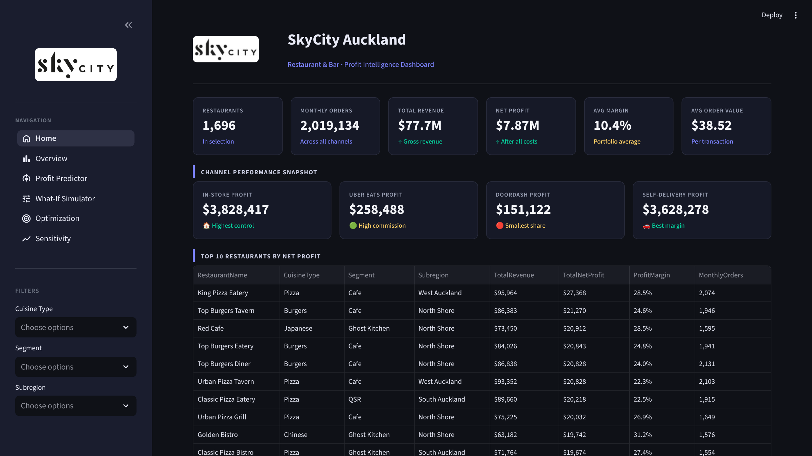

# SkyCity Auckland — Restaurant & Bar Profit Dashboard

**Live app:** https://skycity-auckland-restaurants-bars-profit-dashboard-7ahgbe8axnd.streamlit.app/

A Streamlit dashboard that shows where 1,696 Auckland restaurants make and lose profit across four sales channels: in-store, Uber Eats, DoorDash and self-delivery.

Project 4 of 4 · Built during my Data Analyst Internship at Unified Mentor (Jan–Jul 2026).




## The business question

Restaurants sell through several channels, each with different costs. Which channels actually make money, and where should the portfolio focus?

## Key findings

- **Delivery apps bring volume, not profit.** Uber Eats and DoorDash carry **61%** of orders but earn only **5%** of net profit. Their net margin is under 1%.
- **In-store and self-delivery carry the business.** Together they are 39% of orders but **95%** of profit, with margins of **26.8%** (in-store) and **22.9%** (self-delivery).
- **Per order, the gap is stark.** An in-store order earns **$10.31** profit, while an Uber Eats order earns **$0.32**.
- **Costs matter more than commission.** Food cost rate and operating cost rate have the strongest link to profit (correlations of −0.76 and −0.73). Commission rates only range from 27% to 33%, so they barely move profit.
- **Full-service restaurants lose money overall** (−5.8% margin), while ghost kitchens earn the most (22.2%).

Across the portfolio: $77.7M monthly revenue, $7.87M net profit, a 10.1% margin.

## How it works

1. **Load and prepare** (`app/utils/data_loader.py`): total revenue, total profit, margin, profit per order and channel features for each restaurant.
2. **Six pages**, all with cuisine, segment and subregion filters:
   - **Home:** portfolio KPIs, profit by channel, top 10 restaurants
   - **Overview:** profit by cuisine, segment, channel and subregion
   - **Profit Predictor:** compares Linear Regression, Random Forest and Gradient Boosting, and predicts profit for inputs you choose
   - **What-If Simulator:** tests changes to channel mix, commission and demand
   - **Optimization:** searches for a channel mix under limits you set (SciPy SLSQP solver)
   - **Sensitivity:** shows which cost inputs move profit most

## How well it works

- **The profit model's high score is misleading.** Total profit is calculated from the same inputs the model is given (orders, order value, cost rates), so it can almost rebuild profit from them. This is called **data leakage**. The score shows the model can copy that calculation, not that it can forecast new restaurants.
- **The optimiser needs rework.** It stops after its first step and returns its starting guess. Its "uplift" compares that guess with an average channel mix whose shares add up to more than 100%, so the uplift figure is not a real optimisation result.
- **The descriptive findings above don't depend on either model.** They come straight from adding up revenue and profit by channel.

## Limitations

- **Sample data.** The dataset was provided for the internship. I could not confirm it comes from SkyCity itself, so treat it as sample data.
- **Channel share columns don't add up.** For each restaurant, the four share columns sum to 103%–155%. The findings above use actual order and profit counts instead.
- **One month, no history.** The data is a single snapshot, so it shows where profit comes from, not how it changes.

## Run it locally

```bash
git clone https://github.com/Vipsa2207/SkyCity-Auckland-restaurants-bars-profit-dashboard.git
cd SkyCity-Auckland-restaurants-bars-profit-dashboard
pip install -r requirements.txt
streamlit run app/main.py
```

## Project files

| File | What it is |
|---|---|
| `app/main.py` | Home page |
| `app/pages/` | Overview, Profit Predictor, What-If Simulator, Optimization, Sensitivity |
| `app/utils/data_loader.py` | Loads data and builds features |
| `app/utils/plot_utils.py` | Shared styling and chart helpers |
| `data/` | Restaurant-level dataset (1,696 rows) |

## Research paper

I authored a research paper on this project (JETIR paper ID 583938, accepted, not published).

- [Research paper (revised, November 2026)](docs/Research_Paper_Revised.pdf). It corrects the version submitted to JETIR: the 45.4% uplift and the R² ≈ 0.96–0.97 model scores are withdrawn, and the channel margins and order shares are corrected.
- [Executive summary (revised, November 2026)](docs/Executive_Summary_Revised.pdf)

## How I built it

I used AI to help write the Python code. I framed the business question, checked the outputs against the data, and wrote the findings.

## Author

**Vipsa Patel** — Data Analyst Intern, Unified Mentor · [LinkedIn](https://www.linkedin.com/in/vipsapatel)
